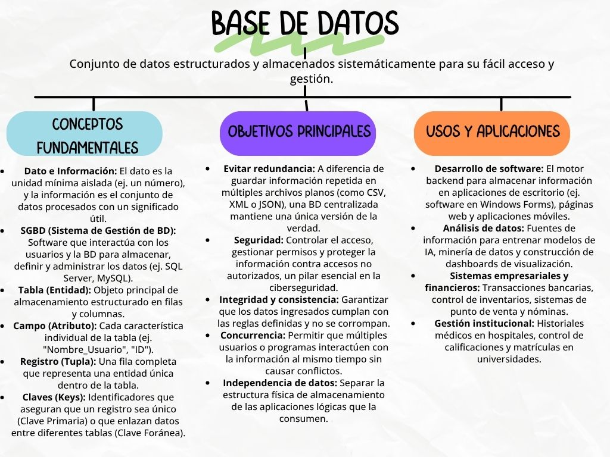
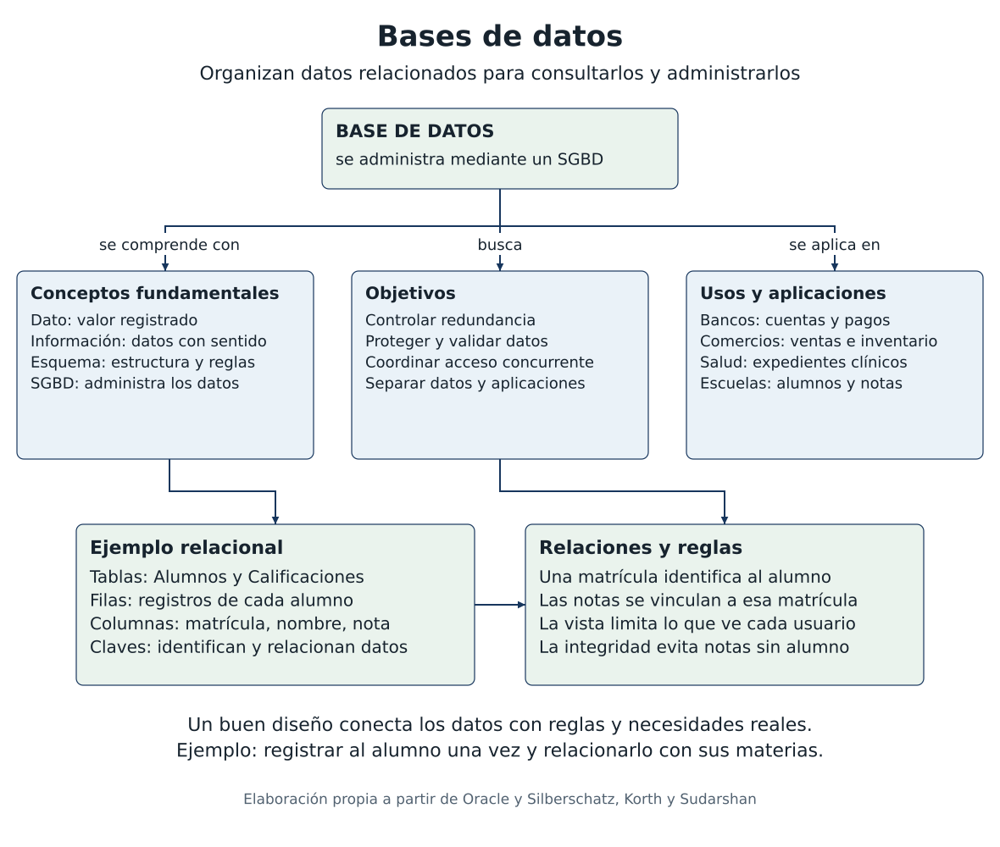

# Tarea 1 1 Fundamentos objetivos y modelos

Autor: Jesús Armando Zendejo Altamirano  
Materia: Fundamentos de Bases de Datos  
Docente: Ruben Riojas

Mapa conceptual

Las bases de datos permiten organizar información relacionada para recuperarla y actualizarla. Su utilidad depende del diseño de los datos, de las reglas de integridad y del control de acceso que aplica el sistema gestor (Oracle, 2020).

Figura 1. Mapa conceptual de conceptos, objetivos y aplicaciones de las bases de datos.

Precisiones de los conceptos

En el mapa, las tablas, los campos, las filas y las claves describen especialmente el modelo relacional. Una entidad es un concepto del mundo real y una tabla puede representar sus ocurrencias; ambos términos no son equivalentes en todos los modelos.

El objetivo de reducir redundancia significa controlar las repeticiones innecesarias mediante un buen diseño. La centralización por sí sola no garantiza una única versión correcta de cada dato. La seguridad y la consistencia también requieren permisos, restricciones y una administración adecuada.

Relaciones del mapa conceptual

Figura 2. Desarrollo analítico del mapa con relaciones entre conceptos, objetivos y aplicaciones. Elaboración propia.

Aplicación y análisis

En una escuela, la matrícula identifica a cada alumno y permite relacionarlo con sus calificaciones. Registrar los datos personales una sola vez disminuye repeticiones; las claves relacionan las tablas y las restricciones evitan registrar notas para alumnos inexistentes. Las vistas y los permisos limitan lo que puede consultar cada usuario (Oracle, 2021).

La elección del sistema debe partir del problema. Un registro escolar requiere integridad y relaciones claras; un catálogo de productos con atributos variables puede aprovechar documentos. El modelo, las reglas y las operaciones deben responder a la información que se necesita tratar.

Tabla comparativa de modelos de bases de datos

Un modelo define cómo se representan y relacionan los datos. Los modelos jerárquico y de red son navegacionales; el relacional utiliza relaciones, y el orientado a objetos conserva objetos persistentes. Los sistemas documentales forman parte de la familia NoSQL (Silberschatz et al., 2019; IBM, s. f.).

Tabla 1. Comparación de los modelos solicitados y del modelo documental.

| Modelo | Definición | Representación |
|---|---|---|
| Relacional | Organiza la información en relaciones y vincula los datos mediante claves. Facilita las consultas y las reglas de integridad. | Tablas bidimensionales estructuradas estrictamente en filas (registros) y columnas (campos). |
| Jerárquico | Organiza la información mediante dependencias de uno a muchos. Cada hijo tiene un único padre dentro de la jerarquía. | Un árbol invertido compuesto por nodos, donde un "padre" puede tener múltiples "hijos", pero un "hijo" solo tiene un "padre". |
| De Red | Evolución del modelo jerárquico diseñado para manejar relaciones complejas de "muchos a muchos", evitando la restricción de un solo padre. | Una estructura de grafo donde los registros (nodos) se interconectan de forma cruzada mediante enlaces o punteros. |
| Orientado a Objetos | Integra conceptos de la POO para conservar objetos con identidad, atributos y relaciones. Sus tipos pueden definir operaciones. | Objetos persistentes definidos por clases o tipos. Pueden incluir referencias a otros objetos y estructuras complejas. |
| Documental (NoSQL) | Organiza datos en documentos con esquema flexible. Puede aplicar validación; la flexibilidad no elimina la necesidad de diseñar los datos. | Colecciones de documentos con campos, listas y estructuras anidadas, por ejemplo en JSON o BSON. |

Interpretación de la comparativa

El modelo jerárquico resulta claro cuando existe una relación estable entre padre e hijos. El modelo de red permite múltiples enlaces entre registros. No debe confundirse este modelo histórico con todas las bases de grafos modernas, aunque ambos empleen conexiones entre datos.

En el modelo relacional, una misma matrícula puede relacionarse con varias inscripciones sin repetir la información del alumno. En el orientado a objetos, se conserva la identidad y estructura de objetos complejos. En el documental, distintos productos pueden tener campos diferentes, aunque sigue siendo necesario definir criterios de validación y consulta.

Referencias de la tarea 1 1

Amazon Web Services (s. f.). ¿Qué es una base de datos? https://aws.amazon.com/es/what-is/database/

IBM (s. f.). ¿Qué es una base de datos NoSQL? https://www.ibm.com/es-es/think/topics/nosql-databases

Oracle (2020, 24 de noviembre). What is a database? https://www.oracle.com/latam/database/what-is-database/

Oracle (2021, 18 de junio). ¿Qué es una base de datos relacional? ¿Qué es Relational Database Management System RDBMS? https://www.oracle.com/latam/database/what-is-a-relational-database/

Silberschatz, A., Korth, H. F., y Sudarshan, S. (2019). Database system concepts (7.ª ed.). McGraw-Hill. https://www.db-book.com/

Conclusión

Comprender los conceptos y modelos de bases de datos ayuda a proponer soluciones de información. Un diseño adecuado relaciona los datos con las necesidades de la organización y define reglas para mantenerlos útiles, consistentes y accesibles para las personas autorizadas.

