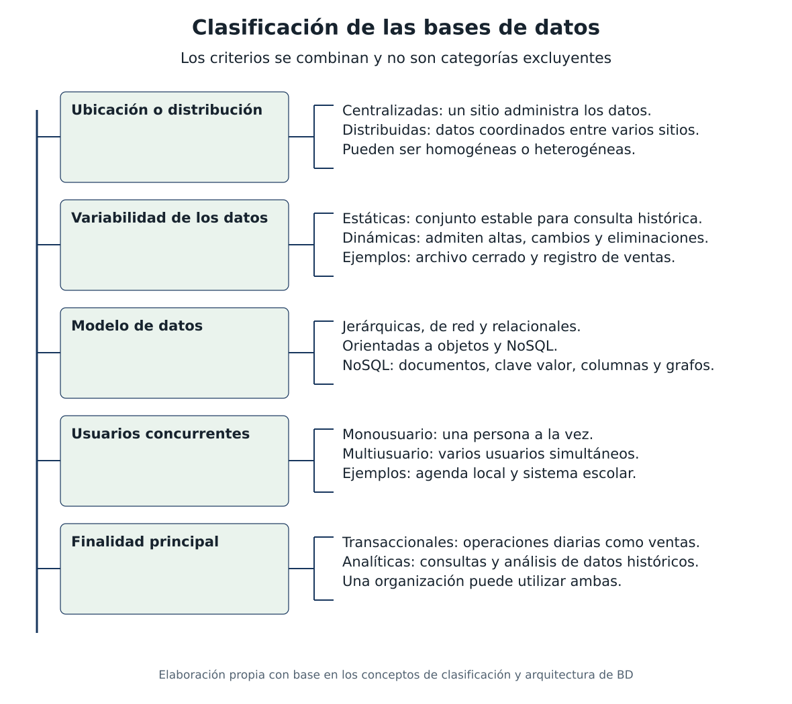
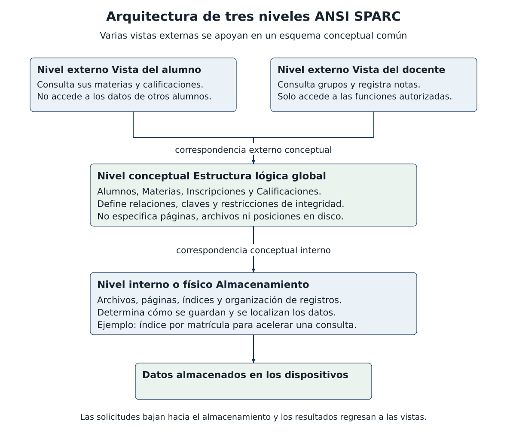
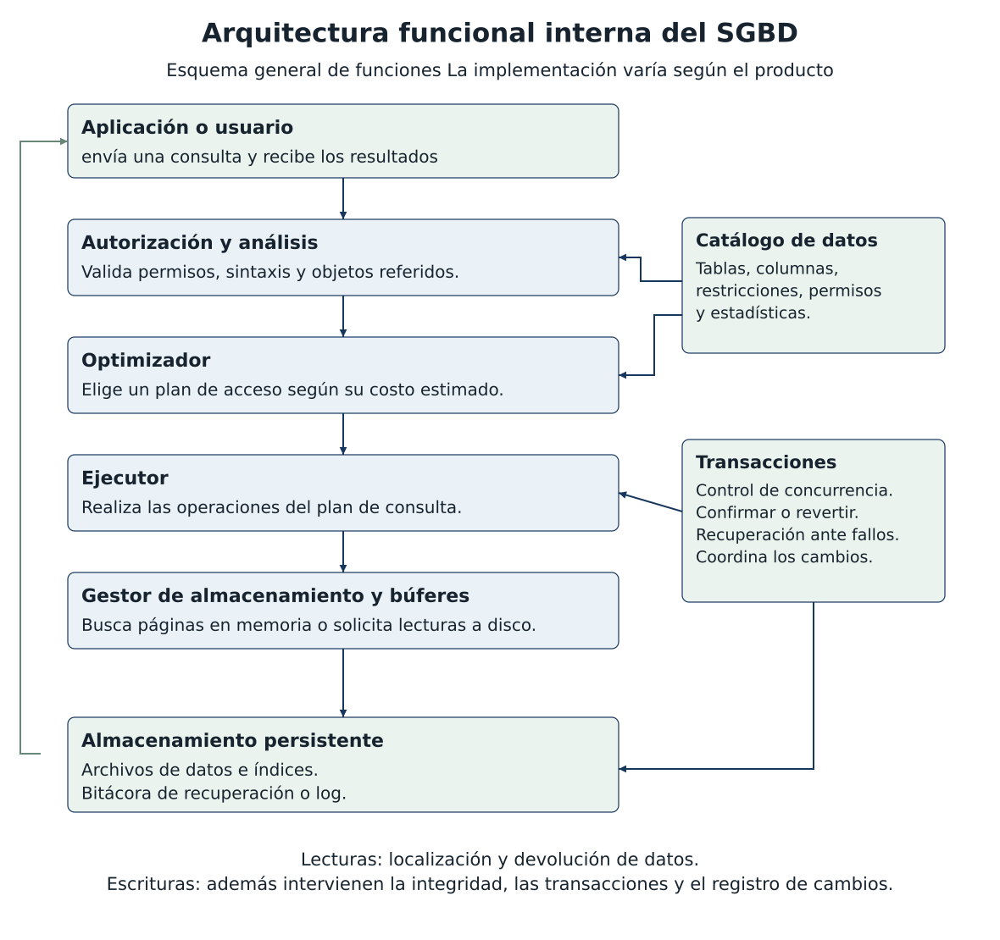

# Tarea 1 2 Clasificación y arquitecturas

Autor: Jesús Armando Zendejo Altamirano  
Materia: Fundamentos de Bases de Datos  
Docente: Ruben Riojas

Cuadro sinóptico de clasificación

Una base de datos puede clasificarse con varios criterios al mismo tiempo. Por ejemplo, un sistema escolar puede ser relacional, dinámico, centralizado y multiusuario. La distribución física y la cantidad de usuarios son criterios distintos (Silberschatz et al., 2019).

Figura 3. Cuadro sinóptico de ubicación, variabilidad, modelo, usuarios y finalidad. Elaboración propia.

En esta clasificación, estática significa que el conjunto se mantiene estable para consulta; no significa que nunca pueda corregirse. Una base dinámica admite cambios frecuentes. El lugar de alojamiento, local o en la nube, es otro criterio: una base en la nube puede ser centralizada o distribuida.

Arquitectura de tres niveles ANSI SPARC

La arquitectura ANSI/SPARC separa la perspectiva de cada usuario, la estructura lógica global y la organización del almacenamiento. Se trata de niveles de abstracción, que no exigen tres computadoras distintas (Database Architecture Framework Task Group, 1985).

Figura 4. Niveles externo, conceptual e interno con sus correspondencias. Elaboración propia basada en el modelo ANSI/SPARC.

El nivel externo presenta vistas ajustadas a cada usuario. El conceptual define entidades, relaciones y restricciones de toda la base. El interno o físico describe cómo se organizan y localizan los datos mediante archivos, páginas e índices.

Flujo entre niveles e independencia de datos

Ejemplo de consulta de calificaciones

1. El alumno abre su vista y solicita sus calificaciones. Esta petición se expresa en el nivel externo.

2. La correspondencia externo conceptual relaciona la petición con los datos del alumno, sus inscripciones y sus notas en el esquema global.

3. El nivel conceptual define qué tablas y relaciones contienen la información requerida, sin imponer una ubicación en disco.

4. La correspondencia conceptual interno permite acceder a las estructuras físicas. El SGBD puede emplear un índice por matrícula para localizar los registros.

5. Los datos recuperados se interpretan según la estructura lógica y se devuelven a la vista solicitada.

6. El alumno recibe sus calificaciones y los campos permitidos por su perfil. Las demás vistas pueden mostrar otro conjunto de datos de la misma base.

Independencia física

Permite modificar el almacenamiento sin cambiar el esquema conceptual ni las aplicaciones que dependen de él. Por ejemplo, agregar un índice o reorganizar archivos puede mejorar una consulta sin modificar la pantalla del alumno (Oracle, 2021; Silberschatz et al., 2019).

Independencia lógica

Permite modificar el esquema conceptual conservando las vistas externas y sus aplicaciones, cuando las correspondencias permiten mantener su significado. Por ejemplo, agregar una entidad de becas no necesita alterar la vista de calificaciones. No todos los cambios lógicos pueden ocultarse automáticamente.

Relación con el SGBD

Los niveles explican cómo se describe la información. Los módulos del SGBD ejecutan las funciones necesarias para traducir las solicitudes, comprobar permisos, elegir accesos y recuperar o modificar los datos. Las dos perspectivas describen aspectos complementarios del mismo sistema.

Arquitectura funcional interna del SGBD

El SGBD recibe solicitudes de las aplicaciones y coordina las funciones que permiten ejecutarlas. El siguiente esquema resume módulos habituales; su separación exacta depende de cada producto (PostgreSQL Global Development Group, s. f.-a).

Figura 5. Módulos y relaciones funcionales de un SGBD. La flecha lateral representa la devolución de resultados. Elaboración propia.

El catálogo apoya la validación y la optimización. El gestor de transacciones coordina la ejecución de cambios y la recuperación; no es un paso que ocurra solamente al final de cada consulta.

Funciones de los módulos y recorrido de una solicitud

Procesamiento de consultas

Autorización y analizador. Verifican que el usuario tenga los permisos necesarios y que la solicitud tenga una sintaxis válida. El catálogo permite identificar tablas, columnas y tipos. Las instrucciones de definición de datos crean o modifican estructuras y actualizan sus metadatos.

Optimizador. Considera formas de obtener el resultado, como recorrer una tabla o utilizar un índice, y estima sus costos. Elige un plan que será ejecutado por el motor; no cambia el significado de la consulta.

Ejecutor. Realiza las operaciones del plan, como búsquedas, filtros, uniones y ordenamientos, y produce los resultados solicitados (PostgreSQL Global Development Group, s. f.-c).

Almacenamiento y catálogo

El gestor de almacenamiento organiza el acceso a archivos, páginas e índices. El gestor de búferes mantiene páginas en memoria y evita lecturas repetidas; si una página no está disponible, solicita su lectura al almacenamiento persistente. El catálogo conserva definiciones y estadísticas que utilizan otros módulos (Silberschatz et al., 2019).

Transacciones concurrencia y recuperación

Una transacción agrupa operaciones que se confirman o se revierten. El control de concurrencia coordina accesos simultáneos mediante mecanismos como bloqueos o versiones; su propósito es evitar resultados incoherentes entre usuarios (PostgreSQL Global Development Group, s. f.-b).

La recuperación utiliza registros de cambios para restaurar un estado consistente después de ciertos fallos. En sistemas con WAL, los registros pertinentes se escriben de forma persistente antes de las páginas de datos modificadas; el log y las copias de seguridad cumplen funciones complementarias (PostgreSQL Global Development Group, s. f.-d).

Ejemplo de registro de una calificación

El docente envía la nueva nota. El sistema comprueba su permiso y valida alumno, materia y rango permitido. El optimizador decide cómo localizar la inscripción y el ejecutor solicita la página correspondiente. El control de concurrencia coordina el cambio con otros accesos y el sistema registra lo necesario para la recuperación. Si todas las operaciones son válidas, se confirma la transacción y se devuelve el resultado; ante un error, se revierte el cambio.

Referencias de la tarea 1 2

Database Architecture Framework Task Group (1985, mayo). Reference model for DBMS standardization NBSIR 85-3173. National Bureau of Standards. https://www.govinfo.gov/content/pkg/GOVPUB-C13-f55f11d78745e6c51f75a39a44913f22/pdf/GOVPUB-C13-f55f11d78745e6c51f75a39a44913f22.pdf

Oracle (2021, 18 de junio). ¿Qué es una base de datos relacional? ¿Qué es Relational Database Management System RDBMS? https://www.oracle.com/latam/database/what-is-a-relational-database/

PostgreSQL Global Development Group (s. f.-a). Architectural fundamentals. PostgreSQL 18 documentation. https://www.postgresql.org/docs/18/tutorial-arch.html

PostgreSQL Global Development Group (s. f.-b). Introduction. Concurrency control. PostgreSQL 18 documentation. https://www.postgresql.org/docs/18/mvcc-intro.html

PostgreSQL Global Development Group (s. f.-c). The path of a query. PostgreSQL 18 documentation. https://www.postgresql.org/docs/18/query-path.html

PostgreSQL Global Development Group (s. f.-d). Write ahead logging WAL. PostgreSQL 18 documentation. https://www.postgresql.org/docs/18/wal-intro.html

Silberschatz, A., Korth, H. F., y Sudarshan, S. (2019). Database system concepts (7.ª ed.). McGraw-Hill. https://www.db-book.com/

Conclusión

La clasificación permite reconocer las necesidades de una base de datos. ANSI/SPARC separa las vistas, la estructura lógica y el almacenamiento; la arquitectura funcional del SGBD explica los módulos que hacen posible consultar y actualizar la información con control de acceso, concurrencia y recuperación.

